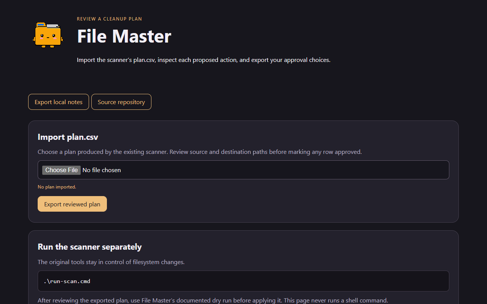

# File Master

Keeps a Windows PC organized. It regularly audits your folders and projects,
points out what's broken or wasteful, and gives you a plan of renames and moves
to approve. **It never deletes anything.**

It has three parts:

| Part | What it is | When it runs |
|---|---|---|
| **Scanner** (`scripts/Invoke-FileMasterScan.ps1`) | A read-only PowerShell audit | Whenever you run it, or on a schedule |
| **`file-master` agent** (`agent/file-master.md`) | A Claude Code subagent that runs the scanner, adds judgment, and walks you through fixes | When you ask Claude to "use file-master" |
| **Weekly routine** | A Claude desktop scheduled task that runs the agent's checklist and sends you a summary | Every Sunday evening while the Claude app is open |

## Pictures



File Master's [program page](https://findastra.github.io/astras-pet-os/apps/file-master-20261008.html) as published in Astra's PetOS.

Screenshots taken 2026-10-17 with GitHub Goldfish's [project-image-generator](https://github.com/findastra/github-goldfish#project-image-generator); added with Claude Opus 5.5 (`claude-opus-5-5`), 2026-10-17.

## What it checks

- **Duplicates.** Large files stored more than once, found by size plus a partial hash and re-checked with a full SHA-256 before anything moves.
- **Partial downloads** (`.opdownload`, `.crdownload`, `.part`)
- **Files with no extension.** It detects the real type (PNG, JPG, PDF, MP4, ZIP, and more) from the file's first bytes.
- **Doubled extensions** like `fix.bat.bat`, which is the hidden-extensions trap.
- **Piles** of installers and `.log` files
- **Empty folders**
- **Sensitive-looking files** (keys, passwords) sitting at a drive root, on the Desktop, or in Documents. Only the name is checked; File Master never opens them.
- **Git repo health.** It flags repos with no commits, no GitHub remote, unpushed or uncommitted work, no `.gitignore`, nested repos, folder/repo name mismatches, and big files about to be committed.
- **Project health,** with extra attention on **emerging projects** (created in the last 21 days). It checks the name, git, README, and whether the folder holds only assets and no code.
- **Stale projects** with no changes in 60 days

## Quick start

```powershell
# 1. Scan (read-only). Opens the report when done.
.\run-scan.cmd

# 2. Review reports\<run-id>\plan.csv and put "yes" in the Approved column for rows you want.

# 3. Dry run, then apply
powershell -ExecutionPolicy Bypass -File .\scripts\Invoke-FileMasterPlan.ps1 -PlanPath .\reports\<run-id>\plan.csv
powershell -ExecutionPolicy Bypass -File .\scripts\Invoke-FileMasterPlan.ps1 -PlanPath .\reports\<run-id>\plan.csv -Apply

# Changed your mind?
powershell -ExecutionPolicy Bypass -File .\scripts\Undo-FileMasterPlan.ps1 -UndoLog .\reports\<run-id>\undo-<time>.jsonl
```

Why `-ExecutionPolicy Bypass`? Windows blocks `.ps1` scripts by default. Bypass
allows just this one run without changing the setting for the whole PC.

### What's a dry run?

A rehearsal. The plan script prints exactly what it *would* move or rename, then stops
without changing anything. Always dry-run first. It catches surprises, like a rename whose
target name already exists, while undoing still costs nothing. Add `-Apply` only once
the dry-run output looks right.

### Plan actions

| Action | What happens |
|---|---|
| `Rename` / `Move` | Item moves to `Destination`. It is skipped if something already exists there. |
| `Quarantine` | Item moves to `<drive>\_file-master-holding\<run-id>\...`, keeping its original folder layout. You empty that folder yourself. |
| `RemoveEmpty` | Folder is removed only if it is still empty |
| `Review` | Report only. Decide by hand or ask the agent. |

## Install the agent

```powershell
powershell -ExecutionPolicy Bypass -File .\scripts\Install-FileMaster.ps1
```

This copies the agent to `%USERPROFILE%\.claude\agents\file-master.md`. In any Claude Code
session you can then say *"use file-master to check my projects"*.

Add `-RegisterWindowsTask` for a weekly scan through Windows Task Scheduler that runs without Claude.

## Configuration

`config/file-master.config.json` holds generic defaults. Copy it to
`config/file-master.config.local.json` (git-ignored) and add your own drives and folders.
The local file takes priority.

| Key | Meaning |
|---|---|
| `roots` | Folders to scan |
| `projectRoots` | Where your projects live (each child folder counts as a project) |
| `driveRoots` | Places checked for exposed sensitive files |
| `skipDirs` / `skipPaths` | Folder names or full paths to ignore |
| `preferKeepUnder` | When duplicates exist, keep the copy under these folders (e.g. your archive drive) |
| `duplicateMinMB`, `largeFileMB`, `repoLargeFileMB` | Size thresholds |
| `emergingProjectDays`, `staleProjectDays` | Project age thresholds |

## Privacy

Reports contain your file paths, so `reports/` is git-ignored. The scanner only reads
file names, sizes, dates, the first 16 bytes (for type detection), and hashes. It does
not read document contents.


## Tools (2026-10-13)

File Master's pet program is `pet-program-12` (no name assigned yet). Its tools follow the
[Pet Program Framework](https://github.com/findastra/astras-pet-os/blob/main/PET-PROGRAM-FRAMEWORK.md): each has its own
tool box on the web app, with its versioned label on the border, ON/OFF and Sick. Both only read; neither changes anything.

### `pet-program-12-v1.0-repo-catcher-v1.0`
Finds repos on this PC that were never pushed, or hold work GitHub does not have (no commits, no remote, a branch
never pushed, commits not pushed, branches with no upstream, uncommitted changes), and marks stale ones. Each row
starts with the folder location (click to open it), then the date it was created; newest at the top.

```powershell
.\scripts\repo-catcher-20261013.ps1          # writes reports\repo-catcher-<run>\repo-catcher.html and .json
```

### `pet-program-12-v1.0-new-programs-watch-v1.0`
Lists programs that are new on this PC, wherever they were installed: the Windows installed-programs list, Start menu
shortcuts, Microsoft Store apps, and, with Everything, any new `.exe` anywhere (portable programs too). The first run
records a baseline in `%LOCALAPPDATA%\file-master\known-programs-v1.json`; later runs list what is new since.

```powershell
.\scripts\new-programs-watch-20261013.ps1     # writes reports\new-programs-<run>\new-programs.html and .json
```

### Optional downloads for whole-PC search
Both tools search the whole PC much faster with Everything. Without it, repo-catcher walks your folders and every
other drive, and new-programs-watch uses the Windows lists only.
- **Everything** (free, voidtools): https://www.voidtools.com/downloads/ (Everything must be running)
- **es.exe**, Everything's command-line tool: https://github.com/voidtools/es/releases, or `winget install voidtools.Everything.Cli`

## File Master web app

*A pet app by Astra.*

Open [file-master-20261008.html](file-master-20261008.html) in a modern browser, or double-click File Master in Astra's PetOS. The nine original pet moods and manifest are included.

Limits: this web app does not install or start Windows programs. Where an existing web app is available, the Cage opens that app. Draft controls store their data in the current browser and do not imply connected services. Existing application instructions above still apply.

Version [v0.1.1-20261008-pets](https://github.com/findastra/file-master/tree/v0.1.1-20261008-pets). Added with OpenAI Codex (GPT-6), 2026-10-08.

## Desktop pet update - 2026-10-11
Latest desktop size: 20% larger than prior half-size multiplier. Desktop artwork status: draft. Manifest: [desktop-pet-20261011.json](desktop-pet-20261011.json). The native companion renders this art; existing browser interface behavior is unchanged. Generated character artwork uses OpenAI image generation; source sheets and derived frames are included where applicable. Public credit: Astra. Integrated by OpenAI Codex (GPT-6).

Desktop appearance draft updated 2026-10-11: see [desktop details](desktop-pet-20261011.json). This changes the desktop pet, not application features.

## Limits

What is not done, plainly. From the hub's [intelligence levels](https://github.com/findastra/astras-pet-os/blob/main/INTELLIGENCE-LEVELS.md) (checked 2026-10-17):

- **Program (L1/L2):** ✅ **Made by Astra:** *File Kingdom*: the [scanner, plan and undo tools](https://github.com/findastra/file-master/tree/main/scripts); **Made by others:** Everything, SpaceSniffer
- **Runtime (L2):** 🟡 **Should:** organize files and find systemic errors; show every mass change before making it, with undo; open or edit programs only after Test Tortoise tests the change and Gatekeeper Goddess and Astra approve it (both planned pets). **Today:** the weekly scan is written
- **Agentic harness (L3):** 🟡 [Claude Code agent file-master](https://github.com/findastra/file-master/blob/main/agent/file-master.md)
